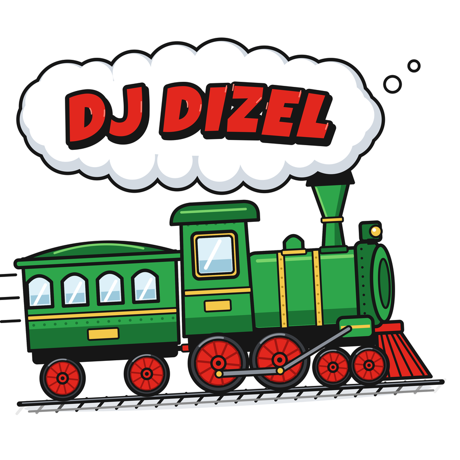

# DJ DIZEL — паровозик в облаке дыма

Вариант 1. Мультяшный винтажный зелёный паровоз с одним пассажирским вагоном, красные колёса со спицами, чёрная труба, большое облако дыма с надписью «DJ DIZEL». Толстые чёрные контуры, плоские заливки, белый фон. Иллюстрация нарисована с нуля по стилю референса и не копирует его.



## Файлы (`exports/`)

| Файл | Что это |
|---|---|
| `dj-dizel_3000x3000.jpg` | финальный растр, 3000×3000 px, 300 dpi, sRGB |
| `dj-dizel.eps` | векторный исходник EPS (Level 3), без растровых вставок |
| `dj-dizel.pdf` | векторный PDF, открывается и редактируется в Adobe Illustrator |
| `dj-dizel.svg` | векторный SVG для Figma, Inkscape и веба |
| `dj-dizel_preview.png` | превью 900×900 |

Надпись во всех векторных файлах переведена в кривые, шрифт устанавливать не нужно.

## Пересборка

```bash
pip install cairosvg fonttools pillow
python src/build.py
```

Цвета, толщина контура (`S`), наклон поезда (`TILT`) и текст надписи (`TEXT`) задаются в начале `src/build.py`.

Шрифт надписи: Luckiest Guy (Apache License 2.0, `src/fonts/`).
